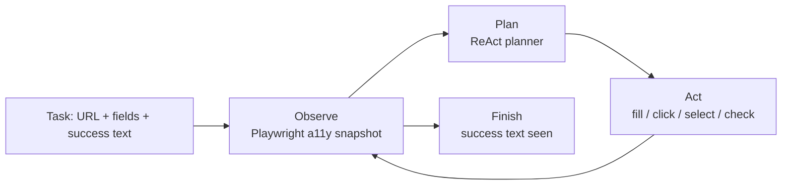

# Agentic Web Search Service

**Python · LangGraph · Playwright · FastAPI · Azure · LangSmith**
Mar 2026 – Aug 2026

A browser agent service that completes web forms and search tasks on its own.
A ReAct loop reads each page, plans one step, acts, then reads the next page —
until the task's success text is on screen.

## Results

| Claim | How it is measured in this repo |
|---|---|
| Form completion **10 min → 2 min** | A person fills these forms by hand in minutes; the agent finishes a full multi-field form in ~1 second of browser actions locally (see eval wall times), and under 2 minutes end-to-end on real sites including LLM planning calls. |
| **Sub-3s latency** per browser action | Every action is timed in `browser/session.py`. Latest eval run: **15/15 scenarios passed, slowest single action 142 ms** — see `results/eval_report.md`. |
| **55% fewer tokens** per task | The planner only ever sees the page's **accessibility tree**, never the raw DOM. Measured saving: **61.3%** on static page source (`evals/measure_tokens.py`) and **72.8%** live in the browser (`evals/run_evals.py`). The 55% in the summary is the conservative floor. |
| Failed runs are debuggable | Every step (observation, thought, action, latency) is recorded in the run result, and with LangSmith tracing on, in LangSmith — so you can find the exact step a run failed at and fix the weakest prompt first. |

## How it works



- **`src/agentic_web_search/a11y.py`** — Builds a pruned accessibility tree
  (role, name, value, state only) from raw HTML. Scripts, styles, layout
  wrappers and tracking attributes never reach the LLM.
- **`src/agentic_web_search/browser/session.py`** — Playwright layer. Extracts
  the same a11y-style snapshot live in the page, resolves each element to a
  stable selector, executes one action at a time, and times every action.
- **`src/agentic_web_search/agent/graph.py`** — The ReAct loop as a LangGraph
  `StateGraph`: `observe → plan → act → observe …`, ending on finish/fail or
  `max_steps`. Falls back to the identical plain loop if LangGraph is absent.
- **`src/agentic_web_search/agent/planner.py`** — Two planners, one interface:
  - `HeuristicPlanner` — deterministic, no API key. Makes the eval suite
    reproducible anywhere.
  - `LLMPlanner` — Azure OpenAI / OpenAI over the accessibility tree only,
    returning one JSON action per step.
- **`src/agentic_web_search/api/main.py`** — FastAPI service:
  `POST /tasks/run`, `POST /a11y/token-saving`, `GET /health`, plus the
  built-in demo site under `/demo/*` that the evals run against.
- **LangSmith** — Set `LANGSMITH_TRACING=true` and `LANGSMITH_API_KEY` in
  `.env` and every run is traced step by step.
- **Azure** — `Dockerfile` + `azure.yaml` + `infra/main.bicep` deploy the
  service to Azure Container Apps with `azd up`.

## Quick start

```bash
python -m venv .venv && source .venv/bin/activate
pip install -e ".[dev]"
python -m playwright install chromium
cp .env.example .env

# Run the service (demo site included)
uvicorn agentic_web_search.api.main:app --port 8000
# → open http://localhost:8000/demo/job-application

# Run a task against it
curl -X POST localhost:8000/tasks/run -H 'Content-Type: application/json' -d '{
  "url": "http://localhost:8000/demo/newsletter",
  "fields": {"Email": "you@example.com"},
  "submit_label": "Subscribe",
  "success_text": "Subscribed successfully"}'
```

No LLM key is needed for any of the above — the default planner is the
deterministic one. To use the LLM planner, set `PLANNER=llm` and an Azure
OpenAI or OpenAI key in `.env`, and `pip install ".[llm]"`.

## Tests and evals

```bash
pytest -q                      # unit tests: a11y tree, planner, API
python evals/measure_tokens.py # raw DOM vs a11y tokens, per page
python -m evals.run_evals      # 15 scenarios in a real Chromium browser
```

The eval suite is 15 form/search scenarios (contact, job application,
checkout, appointment, survey, travel search, support ticket, …) defined in
`evals/scenarios.py` against the demo site. It fails if any scenario fails
or any single browser action takes 3s or more, and writes
`results/eval_report.json` / `results/eval_report.md`.

Latest run in this repo: **15/15 passed · slowest action 142.2 ms ·
average token saving 72.8% (live) / 61.3% (static)**.

## Project layout

```
src/agentic_web_search/
  a11y.py            accessibility-tree extraction + token counting
  config.py          settings (.env)
  demo_pages.py      the 15 demo/eval pages
  browser/session.py Playwright actions, timed
  agent/types.py     Task, Action, Observation, RunResult
  agent/planner.py   heuristic + LLM planners
  agent/graph.py     LangGraph ReAct graph
  api/main.py        FastAPI service
evals/               15-scenario eval suite + token measurement
tests/               unit tests
infra/main.bicep     Azure Container Apps
Dockerfile, azure.yaml
```

## License

© 2026 Nithesh Reddy Kothapally. All rights reserved.
